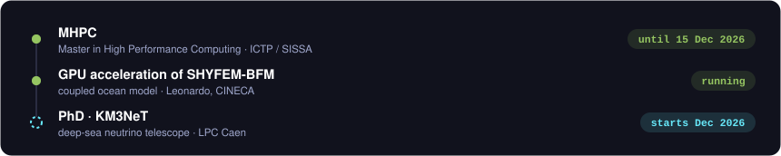

  <picture>
    <source media="(prefers-color-scheme: dark)" srcset="assets/deep-sea-dark.svg"/>
    <source media="(prefers-color-scheme: light)" srcset="assets/deep-sea-light.svg"/>
    
  </picture>
    
  <picture>
    <source media="(prefers-color-scheme: dark)" srcset="assets/terminal-dark.svg"/>
    <source media="(prefers-color-scheme: light)" srcset="assets/terminal-light.svg"/>
    
  </picture>

 

## Now

  <picture>
    <source media="(prefers-color-scheme: dark)" srcset="assets/now-dark.svg"/>
    <source media="(prefers-color-scheme: light)" srcset="assets/now-light.svg"/>
    
  </picture>

## Path

  <picture>
    <source media="(prefers-color-scheme: dark)" srcset="assets/timeline-dark.svg"/>
    <source media="(prefers-color-scheme: light)" srcset="assets/timeline-light.svg"/>
    
  </picture>

## About

  <picture>
    <source media="(prefers-color-scheme: dark)" srcset="assets/about-dark.svg"/>
    <source media="(prefers-color-scheme: light)" srcset="assets/about-light.svg"/>
    
  </picture>

## Skills

  <picture>
    <source media="(prefers-color-scheme: dark)" srcset="assets/flamegraph-dark.svg"/>
    <source media="(prefers-color-scheme: light)" srcset="assets/flamegraph-light.svg"/>
    
  </picture>

Also loaded: Fortran · C · C++ · Python · Bash · MATLAB · SQL · CuPy · PETSc · BLAS/LAPACK · ROOT · Apptainer · CMake · Git · Docker · Ansible · TensorFlow · Keras · NumPy · Pandas · LaTeX · Neovim (built from source on the cluster, obviously)

## Work

  <picture>
    <source media="(prefers-color-scheme: dark)" srcset="assets/work-dark.svg"/>
    <source media="(prefers-color-scheme: light)" srcset="assets/work-light.svg"/>
    
  </picture>

<b>Publications, schools and grants</b>

 

**Publication**
- *MEJ-ESS: An Enhanced Monte Carlo Simulator for Electron Transport in Gaseous Detectors.* A. M. Abdelalim, A. Basyouni, A. Radi, Y. Mohammed, M. Kassab, A. A.-L. Mohamed, M. A. Mahmoud. Manuscript in submission to *Communications Physics* (2025).

**Grants**
- Full fee waiver (CHF 1,650), 48th CERN School of Computing 2026 (admitted)
- Fee waiver (EUR 400), Lake Como School on the Statistical Physics of Deep Learning III, 2026
- Grant (EUR 300), Magurele Summer School on Parallel Algorithms and Optimizations, 2025

**Schools and workshops**
- 2026: Recent Progress in Machine Learning, High-Dimensional Statistics and Inference (ICTP) · Lake Como School on the Statistical Physics of Deep Learning III · TUM Campus Heilbronn HPC Driving AI Summer School (admitted)
- 2025: Magurele Summer School on Parallel Algorithms and Optimizations · Sarajevo School of High Energy Physics · Introduction to Supercomputing at JSC · Interactive HPC with JupyterLab (JSC) · Python Binding for C/C++ (SLING) · 14th Course on Physics at the LHC (LIP) · CERN Dark Showers Workshop · AI Winter School (Brown University)
- 2024: ML4FP School (LBNL) · CMS Open Data Workshop & Hackathon (CERN) · Egypt Scholars Advanced Lab (NLP)

## Contact

  <picture>
    <source media="(prefers-color-scheme: dark)" srcset="assets/ping-dark.svg"/>
    <source media="(prefers-color-scheme: light)" srcset="assets/ping-light.svg"/>
    
  </picture>
    
  <a href="https://www.linkedin.com/in/asmaa-basyouni">
    <picture>
      <source media="(prefers-color-scheme: dark)" srcset="assets/btn-linkedin-dark.svg"/>
      <source media="(prefers-color-scheme: light)" srcset="assets/btn-linkedin-light.svg"/>
      
    </picture>
  </a>
  &nbsp;
  <a href="mailto:asmaa.basyouni@cern.ch">
    <picture>
      <source media="(prefers-color-scheme: dark)" srcset="assets/btn-cern-dark.svg"/>
      <source media="(prefers-color-scheme: light)" srcset="assets/btn-cern-light.svg"/>
      
    </picture>
  </a>
  &nbsp;
  <a href="mailto:abasyoun@sissa.it">
    <picture>
      <source media="(prefers-color-scheme: dark)" srcset="assets/btn-sissa-dark.svg"/>
      <source media="(prefers-color-scheme: light)" srcset="assets/btn-sissa-light.svg"/>
      
    </picture>
  </a>

 

<picture>
    <source media="(prefers-color-scheme: dark)" srcset="assets/statusline-dark.svg"/>
    <source media="(prefers-color-scheme: light)" srcset="assets/statusline-light.svg"/>
    
  </picture>

