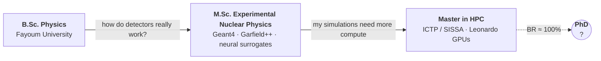

<div align="center">
  
</div>

<br/>

## `$ squeue -u asmaa`

```text
 JOBID  PARTITION  NAME                              ST  TIME     NODELIST(REASON)
 2025   trieste    mhpc_master_ictp_sissa            R   1y+      ictp-sissa
 2026   boost_gpu  port_ocean_model_to_gpu           R   ongoing  leonardo[A100]
 2026   daily      imparare_l_italiano               R   slowly   trieste
 2027   europe     phd_detector_sim_or_ml4physics    PD  0:00     (WaitingForTheRightGroup)
```

```text
$ sacct -u asmaa --state=COMPLETED
 2023-2025  msc_experimental_nuclear_physics  Fayoum University  COMPLETED
            └─ thesis: gas detector simulation with Geant4 + deep learning
 2019-2023  bsc_physics                       Fayoum University  COMPLETED  (very good, 83.31%)
 2023-2025  teaching_cpp_and_geant4           Fayoum University  COMPLETED
```

## `$ nvim about_me.f90`

```fortran
program asmaa
  use physics,  only: nuclear, gaseous_detectors, monte_carlo
  use hpc,      only: mpi, openacc, cuda, slurm
  use learning, only: pytorch, italian
  implicit none                      ! no implicit assumptions, in code or in life

  character(len=*), parameter :: origin = "Egypt", base = "Trieste, Italy"
  logical,          parameter :: takes_it_on_faith = .false.

  do while (code_is_slow())
     call profile()                  ! measure first, guess never
     call port_hot_loop_to_gpu()     ! one loop at a time
     call verify()                   ! bit-identical or it didn't happen
  end do

  if (.not. takes_it_on_faith) call check_it_myself()

  print *, "Looking for a PhD: detector simulation, Monte Carlo, ML for particle physics"
end program asmaa
```

## ⚛️ Decay chain

Every stage was unstable in the best way: it decayed into the next question.



## `$ module list`

```text
Currently Loaded Modules:
  languages/   fortran   c   c++   python   bash   matlab   sql
  parallel/    mpi   openmp   openacc   cuda   cupy   petsc   blas-lapack
  cluster/     slurm   apptainer   perf + flame graphs   cmake   git   docker   ansible
  physics/     geant4   garfield++   root   pythia8   monte-carlo
  ml/          pytorch   tensorflow   keras   scikit-learn   numpy   pandas
  editor/      neovim   (built from source on the cluster, obviously)
```

## `$ ls ~/work`

| | |
|---|---|
| 🌊 **GPU port of a coupled ocean model** | Profiling and porting SHYFEM-BFM to GPUs on Leonardo (CINECA): find the hot loops, move them, prove the answers didn't change. |
| 🎲 **MEJ-ESS** | An enhanced Monte Carlo simulator for electron transport in gaseous detectors. *A. M. Abdelalim, A. Basyouni, A. Radi, et al.*, submitted to *Communications Physics* (2025). |
| 🧠 **Neural surrogates for gas detectors** | ANNs that predict drift velocity, diffusion and Townsend coefficients, used to explore eco-friendly gas mixtures. |
| 🛡️ **RPC neutron sensitivity** | Geant4 study of double-gap resistive plate chambers. |
| 🧰 **On GitHub** | [`Pythia8`](https://github.com/Asmaa-Basyouni/Pythia8) · [`Transport-without-B`](https://github.com/Asmaa-Basyouni/Transport-without-B) · [`nvim-config`](https://github.com/Asmaa-Basyouni/nvim-config) · [`Scripts`](https://github.com/Asmaa-Basyouni/Scripts) |

<details>
<summary><code>$ cat schools_and_grants.txt</code></summary>
<br/>

- Selected for the 48th CERN School of Computing, with a full fee waiver (CHF 1,650)
- Lake Como School on Statistical Physics of Deep Learning III, with a fee waiver (EUR 400)
- ICTP Magurele Summer School on Parallel Algorithms, with a travel grant (EUR 300)
- Sarajevo School of High Energy Physics 2025
- CERN Dark Showers Workshop · CMS Open Data Workshop & Hackathon
- ML4FP School (LBNL) · AI Winter School (Brown University)

</details>

## `$ ping asmaa`

```text
64 bytes from asmaa: time=fast  if you write about physics, GPUs or a PhD position
```

[LinkedIn](https://www.linkedin.com/in/asmaa-basyouni) &nbsp;·&nbsp; [asmaa.basyouni@cern.ch](mailto:asmaa.basyouni@cern.ch) &nbsp;·&nbsp; [abasyoun@sissa.it](mailto:abasyoun@sissa.it)

<br/>

<div align="center">

**شكراً &nbsp;·&nbsp; Thank you &nbsp;·&nbsp; Grazie**


</div>
