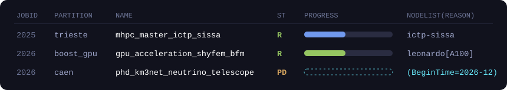

<div align="center">
  
  <br/><br/>
  
</div>

<br/>

## `$ squeue -u asmaa`

<div align="center">
  
</div>

#### `$ sacct -u asmaa --state=COMPLETED`

<div align="center">
  
</div>

## `$ nvim about_me.f90`

```fortran
program asmaa
  use physics,  only: nuclear, gaseous_detectors, monte_carlo, neutrinos
  use hpc,      only: mpi, openacc, cuda, slurm
  use learning, only: pytorch
  implicit none                      ! no implicit assumptions, in code or in life

  logical, parameter :: takes_it_on_faith = .false.
  logical, parameter :: sugar_coating     = .false.   ! direct by default
  integer, parameter :: focus             = huge(1)   ! quiet mode: on

  do while (code_is_slow())
     call profile()                  ! measure first, guess never
     call port_hot_loop_to_gpu()     ! one loop at a time
     call verify()                   ! bit-identical or it didn't happen
  end do

  if (.not. takes_it_on_faith) call check_it_myself()

  print *, "Next: PhD at LPC Caen with KM3NeT, catching neutrinos at the bottom of the sea"
end program asmaa
```

## `$ perf record -g ./asmaa | flamegraph.pl`

<div align="center">
  
</div>

<sub>Also loaded: Fortran · C · C++ · Python · Bash · MATLAB · SQL · CuPy · PETSc · BLAS/LAPACK · ROOT · Apptainer · CMake · Git · Docker · Ansible · TensorFlow · Keras · NumPy · Pandas · LaTeX · Neovim (built from source on the cluster, obviously)</sub>

## `$ ls ~/work`

| | |
|---|---|
| 🌌 **KM3NeT** (from Dec 2026) | PhD at LPC Caen (Université de Caen Normandie, CNRS/IN2P3) on the KM3NeT deep-sea neutrino telescope. |
| 🌊 **GPU acceleration of SHYFEM-BFM** | MHPC project on Leonardo (CINECA): profile the coupled ocean model with perf, FlameGraph and Nsight Systems, offload the hot spots to the GPU, then prove the answers didn't change. |
| 🎲 **MEJ-ESS** | An enhanced Monte Carlo simulator for electron transport in gaseous detectors, built on LXCat cross-sections. *A. M. Abdelalim, A. Basyouni, A. Radi, et al.*, submitted to *Communications Physics* (2025). |
| 🧠 **Neural surrogates for gas detectors** | ANNs that predict drift velocity, diffusion and Townsend coefficients, used to explore eco-friendly gas mixtures. |
| 🛡️ **RPC neutron sensitivity** | Geant4 study of double-gap resistive plate chambers. |
| 💥 **Charged multiplicity in pp collisions** | PYTHIA8 simulations at √s = 14, 20 and 27 TeV: multiplicity across pseudorapidity regions and transverse momentum spectra. |

<details>
<summary><code>$ cat schools_and_grants.txt</code></summary>
<br/>

**Grants**
- Full fee waiver (CHF 1,650), 48th CERN School of Computing 2026 (admitted)
- Fee waiver (EUR 400), Lake Como School on the Statistical Physics of Deep Learning III, 2026
- Grant (EUR 300), Magurele Summer School on Parallel Algorithms and Optimizations, 2025

**Schools and workshops**
- 2026: Recent Progress in Machine Learning, High-Dimensional Statistics and Inference (ICTP) · Lake Como School on the Statistical Physics of Deep Learning III · TUM Campus Heilbronn HPC Driving AI Summer School (admitted)
- 2025: Magurele Summer School on Parallel Algorithms and Optimizations · Sarajevo School of High Energy Physics · Introduction to Supercomputing at JSC · Interactive HPC with JupyterLab (JSC) · Python Binding for C/C++ (SLING) · 14th Course on Physics at the LHC (LIP) · CERN Dark Showers Workshop · AI Winter School (Brown University)
- 2024: ML4FP School (LBNL) · CMS Open Data Workshop & Hackathon (CERN) · Egypt Scholars Advanced Lab (NLP)

</details>

## `$ ping asmaa`

```text
64 bytes from asmaa: time=fast  if you write about neutrinos, GPUs or Monte Carlo
```

[LinkedIn](https://www.linkedin.com/in/asmaa-basyouni) &nbsp;·&nbsp; [asmaa.basyouni@cern.ch](mailto:asmaa.basyouni@cern.ch) &nbsp;·&nbsp; [abasyoun@sissa.it](mailto:abasyoun@sissa.it)

<br/>

<div align="center">


</div>
